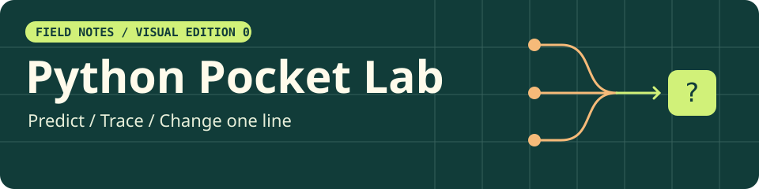
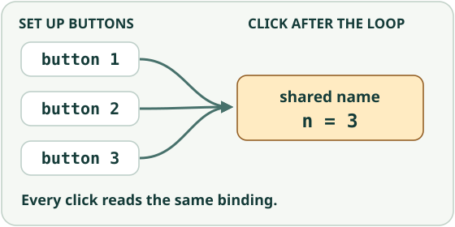
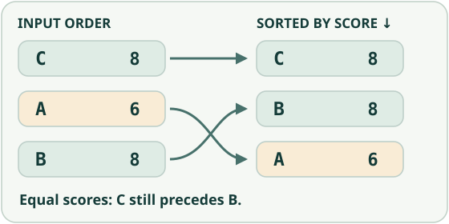

# Python Pocket Lab · 16 predictions



Start with the four illustrated puzzles. Commit to an output, follow the diagram, then change one line to make the other output true. The remaining twelve are quick rounds in text, music, tests and measurement.

[فارسی](PLAY.md) · [English](PLAY.en.md) · [Offline HTML](https://github.com/MohammadaliMasjedi-source/a-byte-of-python-fa/raw/refs/heads/main/labs/python-pocket-lab.html) · [اتاق معماها / Puzzle desk](https://github.com/MohammadaliMasjedi-source/a-byte-of-python-fa/issues/6)

<a name="shared-rows"></a>

## One write to a grid. What will you read back?

```python
grid = [[0, 0]] * 3
grid[0][1] = 7
print([row[1] for row in grid])
```

`[7, 0, 0]`　/　`[7, 7, 7]`

<details><summary>Made a prediction? Reveal the explanation</summary>

**Output: `[7, 7, 7]`**

Multiplication creates three slots in the outer list, all pointing to the same inner list. The assignment changes one inner slot; the final loop reads that same slot three times.

![Three arrows from grid[0], grid[1], and grid[2] converge on one row. Its second slot now holds 7.](diagrams/shared-rows.svg)

**Why the other answer is tempting**　The answer [7, 0, 0] would require three independently created row lists.

</details>

**Round two: change one thing**　Replace the first line with grid = [[0, 0] for _ in range(3)]. Where should the arrows point now?

<details><summary>See the modified example and its output</summary>

```python
grid = [[0, 0] for _ in range(3)]
grid[0][1] = 7
print([row[1] for row in grid])
```

`[7, 0, 0]`

</details>

[Python FAQ: multidimensional lists](https://docs.python.org/3/faq/programming.html#how-do-i-create-a-multidimensional-list)

<a name="one-way-stream"></a>

## What is left of the melody on a second pass?

```python
notes = iter(["A", "B", "C"])
next(notes)
list(notes)
print(list(notes))
```

`[]`　/　`['B', 'C']`

<details><summary>Made a prediction? Reveal the explanation</summary>

**Output: `[]`**

next consumes A. The first list call consumes B and C; discarding its return value does not rewind the iterator. At print time there is nothing left.

![The sequence of return values is A, then [B, C], then an empty list.](diagrams/one-way-stream.svg)

**Why the other answer is tempting**　A list can be iterated from the start again; this iterator keeps advancing from its current position.

</details>

**Round two: change one thing**　Remove only the third line. Which two notes will print?

<details><summary>See the modified example and its output</summary>

```python
notes = iter(["A", "B", "C"])
next(notes)
print(list(notes))
```

`['B', 'C']`

</details>

[Python: iterator types](https://docs.python.org/3/library/stdtypes.html#iterator-types)

<a name="late-buttons"></a>

## Three callbacks, three clicks. Which numbers appear?

```python
def make_buttons():
    return [lambda: n for n in (1, 2, 3)]

buttons = make_buttons()
print([click() for click in buttons])
```

`[1, 2, 3]`　/　`[3, 3, 3]`

<details><summary>Made a prediction? Reveal the explanation</summary>

**Output: `[3, 3, 3]`**

Building the callbacks does not execute their bodies. All three read the same enclosing binding for n. By the time we call them, the loop has finished with n equal to 3.



**Why the other answer is tempting**　Creating a function is not a snapshot of the variable’s value. Here the value is looked up when the function runs.

</details>

**Round two: change one thing**　Replace lambda: n with lambda n=n: n. When does each function get its default value?

<details><summary>See the modified example and its output</summary>

```python
def make_buttons():
    return [lambda n=n: n for n in (1, 2, 3)]

buttons = make_buttons()
print([click() for click in buttons])
```

`[1, 2, 3]`

</details>

[Python FAQ: lambdas in loops](https://docs.python.org/3/faq/programming.html#why-do-lambdas-defined-in-a-loop-with-different-values-all-return-the-same-result)

<a name="stable-ties"></a>

## Two samples tie. Which one comes first?

```python
samples = [("C", 8), ("A", 6), ("B", 8)]
ranked = sorted(samples, key=lambda s: s[1],
                reverse=True)
print(" ".join(name for name, score in ranked))
```

`C B A`　/　`B C A`

<details><summary>Made a prediction? Reveal the explanation</summary>

**Output: `C B A`**

Only the score is used as the key. C and B tie at 8, so a stable sort retains their original order even with reverse=True. A scores 6 and follows both.



**Why the other answer is tempting**　A descending stable sort is not “sort ascending, then reverse the entire list.” That alternative would reverse the tied pair too.

</details>

**Round two: change one thing**　Swap only B and C in the input. Which part of the ordering rule stays the same?

<details><summary>See the modified example and its output</summary>

```python
samples = [("B", 8), ("A", 6), ("C", 8)]
ranked = sorted(samples, key=lambda s: s[1],
                reverse=True)
print(" ".join(name for name, score in ranked))
```

`B C A`

</details>

[Python: sort stability](https://docs.python.org/3/howto/sorting.html#sort-stability-and-complex-sorts)

<a name="q1"></a>

## One letter. How many bytes?

```python
print(len("آ".encode("utf-8")))
```

`1`　/　`2`

<details><summary>Made a prediction? Reveal the explanation</summary>

**Output: `2`**

UTF-8 uses two bytes for this letter. One is the number of Unicode code points before encoding.

</details>

[Python reference](https://docs.python.org/3/library/stdtypes.html#str.encode)

<a name="q2"></a>

## Two strings, one shape?

```python
print("آ" == "ا" + "\u0653")
```

`False`　/　`True`

<details><summary>Made a prediction? Reveal the explanation</summary>

**Output: `False`**

The first string contains one code point. The second contains an alef and a combining mark. They can look alike without comparing equal.

</details>

[Python reference](https://docs.python.org/3/library/unicodedata.html#unicodedata.normalize)

<a name="q3"></a>

## What stayed in the old lesson list?

```python
lessons = ["نور"]
old = lessons.copy()
lessons.append("صدا")
print(len(old))
```

`2`　/　`1`

<details><summary>Made a prediction? Reveal the explanation</summary>

**Output: `1`**

The shallow copy was made before the second lesson was appended. Plain assignment would have kept both names pointing to the same list.

</details>

[Python reference](https://docs.python.org/3/tutorial/datastructures.html#more-on-lists)

<a name="q4"></a>

## The list is sorted. What did sort return?

```python
scores = [8, 2, 5]
print(scores.sort())
```

`[2, 5, 8]`　/　`None`

<details><summary>Made a prediction? Reveal the explanation</summary>

**Output: `None`**

sort() changes the list in place and returns None. To see the sorted values, print the list afterwards.

</details>

[Python reference](https://docs.python.org/3/tutorial/datastructures.html#more-on-lists)

<a name="q5"></a>

## Two frames tie. Which index wins?

```python
scores = [12, 19, 19, 10]
print(max(range(len(scores)), key=scores.__getitem__))
```

`1`　/　`2`

<details><summary>Made a prediction? Reveal the explanation</summary>

**Output: `1`**

max keeps the first maximum. Both scores are 19, but index 1 comes first.

</details>

[Python reference](https://docs.python.org/3/library/functions.html#max)

<a name="q6"></a>

## Three photos, two labels. How many pairs?

```python
print(len(list(zip(["a", "b", "c"], [10, 12]))))
```

`2`　/　`3`

<details><summary>Made a prediction? Reveal the explanation</summary>

**Output: `2`**

Ordinary zip stops when the shorter input runs out. It does not invent a label for the last photo.

</details>

[Python reference](https://docs.python.org/3/library/functions.html#zip)

<a name="q7"></a>

## Did the sensor record anything?

```python
readings = [0, 0]
print(bool(readings), any(readings))
```

`False False`　/　`True False`

<details><summary>Made a prediction? Reveal the explanation</summary>

**Output: `True False`**

A list with two zeroes is nonempty, so its truth value is True. Neither reading is truthy, so any returns False.

</details>

[Python reference](https://docs.python.org/3/library/stdtypes.html#truth-value-testing)

<a name="q8"></a>

## Where did the leading zero go?

```python
print(int("۰۷") + 1)
```

`8`　/　`۰۸`

<details><summary>Made a prediction? Reveal the explanation</summary>

**Output: `8`**

int accepts decimal digits written in Persian. The integer retains neither the spelling nor the leading zero.

</details>

[Python reference](https://docs.python.org/3/library/functions.html#int)

<a name="music"></a>

## Where does beat seven land?

```python
from itertools import cycle, islice
bar = cycle(["DUM", "tak", "tak"])
print(next(islice(bar, 6, None)))
```

`tak`　/　`DUM`

<details><summary>Made a prediction? Reveal the explanation</summary>

**Output: `DUM`**

Six beats make two whole bars of three. Skipping them puts us back on the first sound.

</details>

[Python reference](https://docs.python.org/3/library/itertools.html#itertools.cycle)

<a name="pitch"></a>

## One semitone below the reference: which octave?

```python
semitones = -1
print(semitones // 12, semitones % 12)
```

`-1 11`　/　`0 -1`

<details><summary>Made a prediction? Reveal the explanation</summary>

**Output: `-1 11`**

Floor division rounds down. The octave is −1 and the position inside that octave is 11: −1 = 12 × (−1) + 11.

</details>

[Python reference](https://docs.python.org/3/reference/expressions.html#binary-arithmetic-operations)

<a name="qa"></a>

## Which check failed first?

```python
passed = [True, False, False]
print(next(n for n, ok in enumerate(passed, 1) if not ok))
```

`1`　/　`2`

<details><summary>Made a prediction? Reveal the explanation</summary>

**Output: `2`**

Numbering explicitly starts at one. next takes just the first failed check.

</details>

[Python reference](https://docs.python.org/3/library/functions.html#enumerate)

<a name="meter"></a>

## What happens at two exact ties?

```python
print(round(2.5), round(3.5))
```

`2 4`　/　`3 4`

<details><summary>Made a prediction? Reveal the explanation</summary>

**Output: `2 4`**

At these exactly representable ties, round chooses the even integer. That differs from rounding every half upward.

</details>

[Python reference](https://docs.python.org/3/library/functions.html#round)
