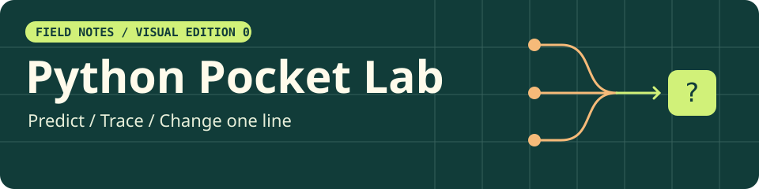
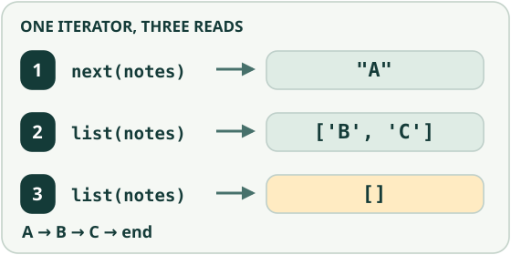
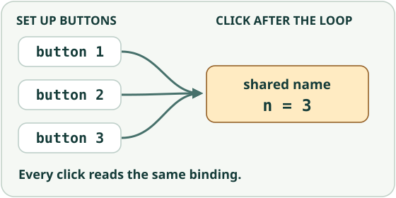
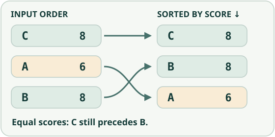

# آزمایشگاه مصور پایتون



وقتی سه ردیفِ یک جدول را می‌سازی، ممکن است پایتون فقط **یک** ردیف در حافظه داشته باشد؟ اول حدس بزن. بعد پیکان‌های شکل را دنبال کن؛ آخر سر یک خط را عوض کن تا جواب دیگر درست شود.

**مسیرت را انتخاب کن:** [جدول و حافظه](#shared-rows) · [ملودی و پیمایشگر](#one-way-stream) · [دکمه‌ها و زمان اجرا](#late-buttons) · [رتبه‌بندی و تساوی](#stable-ties)

اگر تازه شروع کرده‌ای، از [۸ معمای پایه](#q1) برو. [۴ معمای موسیقی، تست و اندازه‌گیری](ENCORE.fa.md) هم یک مسیر مستقل‌اند. برای امتیاز و مرور خطاها، [نسخهٔ آفلاین](https://github.com/MohammadaliMasjedi-source/a-byte-of-python-fa/raw/refs/heads/main/labs/python-pocket-lab.html) را ذخیره کن و در مرورگر باز کن.

[فارسی](PLAY.md) · [English](PLAY.en.md) · [Offline HTML](https://github.com/MohammadaliMasjedi-source/a-byte-of-python-fa/raw/refs/heads/main/labs/python-pocket-lab.html) · [اتاق معماها / Puzzle desk](https://github.com/MohammadaliMasjedi-source/a-byte-of-python-fa/issues/6)

<a name="shared-rows"></a>

## یک خانه را عوض کن؛ موقع چاپ چه می‌بینی؟

```python
grid = [[0, 0]] * 3
grid[0][1] = 7
print([row[1] for row in grid])
```

`[7, 0, 0]`　/　`[7, 7, 7]`

<details><summary>حدست را زدی؟ پاسخ و دلیل</summary>

**خروجی: `[7, 7, 7]`**

ضرب در سه، سه خانه در فهرست بیرونی می‌سازد؛ اما هر سه خانه به همان فهرست درونی اشاره می‌کنند. پس وقتی خانهٔ دومِ یک ردیف را تغییر می‌دهی، هر سه بار همان خانه را می‌خوانی.

![سه پیکان از grid[0]، grid[1] و grid[2] به یک ردیف می‌رسند. خانهٔ دوم آن ردیف ۷ است.](diagrams/shared-rows.svg)

**چرا گزینهٔ دیگر وسوسه‌کننده است؟**　جواب [7, 0, 0] وقتی درست بود که برای هر ردیف، یک فهرست جدا ساخته بودیم.

</details>

**بار دوم: یک تغییر**　سطر اول را به grid = [[0, 0] for _ in range(3)] تغییر بده. حالا چند پیکان باید بکشی؟

<details><summary>نسخهٔ تغییریافته و نتیجه</summary>

```python
grid = [[0, 0] for _ in range(3)]
grid[0][1] = 7
print([row[1] for row in grid])
```

`[7, 0, 0]`

</details>

[ساختن فهرست چندبعدی](https://docs.python.org/3/faq/programming.html#how-do-i-create-a-multidimensional-list)

<a name="one-way-stream"></a>

## بار دوم چه چیزی از ملودی مانده؟

```python
notes = iter(["A", "B", "C"])
next(notes)
list(notes)
print(list(notes))
```

`[]`　/　`['B', 'C']`

<details><summary>حدست را زدی؟ پاسخ و دلیل</summary>

**خروجی: `[]`**

next نت اول را مصرف می‌کند. فراخوانی بعدیِ list هر دو نت باقی‌مانده را می‌خواند؛ دور ریختن نتیجه، آن دو نت را برنمی‌گرداند. پس موقع چاپ، پیمایشگر به آخر رسیده است.



**چرا گزینهٔ دیگر وسوسه‌کننده است؟**　اگر پیمایشگر را مثل فهرست ببینی، انتظار داری هر بار از اول بخواند. پیمایشگر جای خواندن را جلو می‌برد.

</details>

**بار دوم: یک تغییر**　فقط سطر سوم را حذف کن. پیش از اجرا بگو کدام دو نت چاپ می‌شوند.

<details><summary>نسخهٔ تغییریافته و نتیجه</summary>

```python
notes = iter(["A", "B", "C"])
next(notes)
print(list(notes))
```

`['B', 'C']`

</details>

[پیمایشگرها](https://docs.python.org/3/library/stdtypes.html#iterator-types)

<a name="late-buttons"></a>

## سه دکمه، سه بار کلیک؛ چه عددهایی می‌شنوی؟

```python
def make_buttons():
    return [lambda: n for n in (1, 2, 3)]

buttons = make_buttons()
print([click() for click in buttons])
```

`[1, 2, 3]`　/　`[3, 3, 3]`

<details><summary>حدست را زدی؟ پاسخ و دلیل</summary>

**خروجی: `[3, 3, 3]`**

وقتی دکمه‌ها ساخته می‌شوند، بدنهٔ lambda اجرا نمی‌شود. هر سه تابع نام n را از همان محدوده می‌خوانند. تا وقتی روی دکمه‌ها «کلیک» می‌کنیم، حلقه تمام شده و مقدار n برابر ۳ است.



**چرا گزینهٔ دیگر وسوسه‌کننده است؟**　ساختن تابع با عکس‌گرفتن از مقدار متغیر فرق دارد. در این مثال مقدار در زمان فراخوانی خوانده می‌شود.

</details>

**بار دوم: یک تغییر**　به‌جای lambda: n بنویس lambda n=n: n. این بار مقدار پیش‌فرض هر تابع چه زمانی تعیین می‌شود؟

<details><summary>نسخهٔ تغییریافته و نتیجه</summary>

```python
def make_buttons():
    return [lambda n=n: n for n in (1, 2, 3)]

buttons = make_buttons()
print([click() for click in buttons])
```

`[1, 2, 3]`

</details>

[توابع ساخته‌شده در حلقه](https://docs.python.org/3/faq/programming.html#why-do-lambdas-defined-in-a-loop-with-different-values-all-return-the-same-result)

<a name="stable-ties"></a>

## دو نمونه هم‌امتیازند؛ کدام جلو می‌افتد؟

```python
samples = [("C", 8), ("A", 6), ("B", 8)]
ranked = sorted(samples, key=lambda s: s[1],
                reverse=True)
print(" ".join(name for name, score in ranked))
```

`C B A`　/　`B C A`

<details><summary>حدست را زدی؟ پاسخ و دلیل</summary>

**خروجی: `C B A`**

کلید مرتب‌سازی فقط امتیاز است. C و B امتیاز یکسان دارند و مرتب‌سازی پایدار ترتیب اولیهٔ آن‌ها را حفظ می‌کند؛ حتی وقتی reverse=True باشد. A چون امتیاز ۶ دارد بعد از هر دو می‌آید.



**چرا گزینهٔ دیگر وسوسه‌کننده است؟**　reverse=True به معنی «اول صعودی مرتب کن، سپس کل خروجی را از آخر بخوان» نیست؛ آن روش ترتیب اعضای مساوی را هم برعکس می‌کند.

</details>

**بار دوم: یک تغییر**　جای B و C را فقط در فهرست ورودی عوض کن. هنوز کدام بخش قانون ثابت می‌ماند؟

<details><summary>نسخهٔ تغییریافته و نتیجه</summary>

```python
samples = [("B", 8), ("A", 6), ("C", 8)]
ranked = sorted(samples, key=lambda s: s[1],
                reverse=True)
print(" ".join(name for name, score in ranked))
```

`B C A`

</details>

[پایداری مرتب‌سازی](https://docs.python.org/3/howto/sorting.html#sort-stability-and-complex-sorts)

---

# هشت حدس کوتاه

<a name="q1"></a>

## ۱. یک حرف، چند بایت؟

```python
print(len("آ".encode("utf-8")))
```

<details>
<summary><code>1</code></summary>

یک بار دیگر نگاه کن. یک، تعداد کدپوینت‌های همین رشته است؛ بعد از encode داریم بایت می‌شماریم.

</details>

<details>
<summary><code>2</code></summary>

درست حدس زدی. UTF-8 برای این حرف دو بایت لازم دارد.

</details>

[لینک همین سؤال](https://github.com/MohammadaliMasjedi-source/a-byte-of-python-fa/blob/main/labs/PLAY.md#q1)

<a name="q2"></a>

## ۲. یک شکل، دو رشته؟

```python
print("آ" == "ا" + "\u0653")
```

<details>
<summary><code>False</code></summary>

درست حدس زدی. نمایش یکسان می‌تواند از دو توالی متفاوت یونیکد ساخته شود.

</details>

<details>
<summary><code>True</code></summary>

یک بار دیگر نگاه کن. چشم شکل را می‌بیند، اما پایتون توالی کدپوینت‌ها را مقایسه می‌کند.

</details>

[لینک همین سؤال](https://github.com/MohammadaliMasjedi-source/a-byte-of-python-fa/blob/main/labs/PLAY.md#q2)

<a name="q3"></a>

## ۳. چند درس در نسخهٔ قدیمی ماند؟

```python
lessons = ["نور"]
old = lessons.copy()
lessons.append("صدا")
print(len(old))
```

<details>
<summary><code>2</code></summary>

یک بار دیگر نگاه کن. اگر نوشته بودیم old = lessons این پاسخ درست بود.

</details>

<details>
<summary><code>1</code></summary>

درست حدس زدی. کپی پیش از اضافه‌شدن «صدا» ساخته شده است.

</details>

[لینک همین سؤال](https://github.com/MohammadaliMasjedi-source/a-byte-of-python-fa/blob/main/labs/PLAY.md#q3)

<a name="q4"></a>

## ۴. مرتب شد؛ ولی چه چیزی برگشت؟

```python
scores = [8, 2, 5]
print(scores.sort())
```

<details>
<summary><code>[2, 5, 8]</code></summary>

یک بار دیگر نگاه کن. این نتیجهٔ print(scores) بعد از مرتب‌سازی است؛ سؤال دربارهٔ خروجی خود sort بود.

</details>

<details>
<summary><code>None</code></summary>

درست حدس زدی. خود فهرست مرتب شد. متد sort مقدار تازه‌ای برنمی‌گرداند.

</details>

[لینک همین سؤال](https://github.com/MohammadaliMasjedi-source/a-byte-of-python-fa/blob/main/labs/PLAY.md#q4)

<a name="q5"></a>

## ۵. کدام عکس در تساوی برنده است؟

```python
scores = [12, 19, 19, 10]
print(max(range(len(scores)), key=scores.__getitem__))
```

<details>
<summary><code>1</code></summary>

درست حدس زدی. هر دو عکس امتیاز ۱۹ دارند؛ max اولین بیشینه را نگه می‌دارد.

</details>

<details>
<summary><code>2</code></summary>

یک بار دیگر نگاه کن. شمارهٔ ۲ هم بالاترین امتیاز را دارد، ولی بعد از شمارهٔ ۱ آمده است.

</details>

[لینک همین سؤال](https://github.com/MohammadaliMasjedi-source/a-byte-of-python-fa/blob/main/labs/PLAY.md#q5)

<a name="q6"></a>

## ۶. برای سه عکس و دو برچسب چند جفت داریم؟

```python
print(len(list(zip(["a", "b", "c"], [10, 12]))))
```

<details>
<summary><code>2</code></summary>

درست حدس زدی. با تمام‌شدن برچسب‌ها، zip عادی متوقف می‌شود.

</details>

<details>
<summary><code>3</code></summary>

یک بار دیگر نگاه کن. zip برای عکس سوم خودش برچسب خالی نمی‌سازد.

</details>

[لینک همین سؤال](https://github.com/MohammadaliMasjedi-source/a-byte-of-python-fa/blob/main/labs/PLAY.md#q6)

<a name="q7"></a>

## ۷. آیا اندازه‌گیری انجام شده؟

```python
readings = [0, 0]
print(bool(readings), any(readings))
```

<details>
<summary><code>False False</code></summary>

یک بار دیگر نگاه کن. دو خوانش صفر با نداشتنِ هیچ خوانشی فرق دارد.

</details>

<details>
<summary><code>True False</code></summary>

درست حدس زدی. فهرست خالی نیست، اما هیچ عضوی مقدارِ درست ندارد.

</details>

[لینک همین سؤال](https://github.com/MohammadaliMasjedi-source/a-byte-of-python-fa/blob/main/labs/PLAY.md#q7)

<a name="q8"></a>

## ۸. صفرِ اول کجا رفت؟

```python
print(int("۰۷") + 1)
```

<details>
<summary><code>8</code></summary>

درست حدس زدی. رقم‌ها برای محاسبه به عدد تبدیل شده‌اند؛ صفر اول جزو مقدار عدد نیست.

</details>

<details>
<summary><code>۰۸</code></summary>

یک بار دیگر نگاه کن. اعداد پایتون شکل رقم یا قالب ورودی را نگه نمی‌دارند.

</details>

[لینک همین سؤال](https://github.com/MohammadaliMasjedi-source/a-byte-of-python-fa/blob/main/labs/PLAY.md#q8)

[ادامهٔ بازی: چهار معمای ریتم، گیتار، تست نرم‌افزار و اندازه‌گیری](ENCORE.fa.md) · [Play in English](PLAY.en.md)

**چند تا را بار اول درست گفتی؟** برای هر حدس اشتباه یک چیز را در کد عوض کن تا جوابِ دیگرت درست از آب دربیاید. مثلاً در سؤال سوم فقط `.copy()` را بردار.

[اجرای همین ایده‌ها با پایتون و دیدن منابع](README.md) · [آزمایش فوکوس بدون دوربین](https://github.com/MohammadaliMasjedi-source/rpi-camera-af/blob/main/examples/focus_scores.py) · [یک معمای تازه پیشنهاد بده](https://github.com/MohammadaliMasjedi-source/a-byte-of-python-fa/issues) · [پروفایل سازنده](https://github.com/MohammadaliMasjedi-source)

این بازی مکمل مستقلِ ترجمه است. [مجوز متن](../LICENSE) · [مجوز کد](../LICENSE-CODE)
